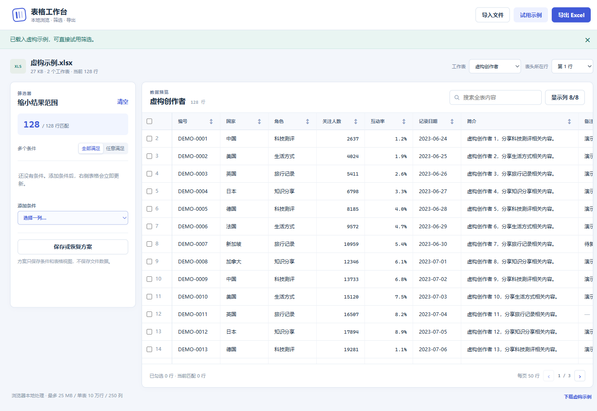

# Excel 筛选工作台

在浏览器里查看、筛选 Excel，再把匹配记录导出为新的 `.xlsx`。适合长表、宽表和简介等长文本。文件在本机浏览器内处理。

An offline Excel viewer with composable filters and XLSX export. No server, account or upload is required.



## 直接使用

在线版：[打开 Excel 筛选工作台](https://jialep38-png.github.io/excel-workbench/)。公开页面无需登录；首次加载需要网络，导入的 Excel 仍在本机浏览器内处理，不会上传到服务器。部署方法见 [在线部署说明](docs/online.md)。

离线版可从 [GitHub Releases](https://github.com/jialep38-png/excel-workbench/releases/latest) 下载单文件 HTML。也可以自行构建后双击 `release/Excel筛选工作台.html`，用 Chrome 或 Edge 打开。这个文件包含全部脚本和样式，可复制到其他电脑、断网使用，无需安装 Excel 或 Node.js。

1. 选择或拖入 `.xlsx`、`.xls`、`.csv` 文件，也可以先试用虚构示例。
2. 选择工作表。如果文件前面有说明文字，调整“表头所在行”。下拉可快速选择前 20 行，也可选“自定义行号…”输入更后的表头行。
3. 在筛选面板选择列，设置数值/日期区间、分类多选、文字或空值条件。多个条件可选“全部满足”或“任意满足”。
4. 搜索、排序、隐藏无关列，打开行详情查看完整内容。结果较多时分页浏览。
5. 点击导出。默认导出全部筛选结果，可选择只导出可见列，或导出当前结果中勾选的记录。

数值范围包含上下边界，留空表示不限制该端。百分比列按显示单位填写，例如 `2` 表示 `2%`。文本里的 `12,500`、`12.5K`、`1.2M`、`3万` 可用于数值筛选，原始文字在导出时仍保留。空值不算零，可用独立空值条件查找。

筛选方案可以命名保存和恢复。文件不会上传，保存方案不会保存完整工作簿；主动保存方案时，当前浏览器会保留表头、筛选值、搜索词和界面设置，用完可在“保存或恢复方案”中删除。关闭页面后重新导入文件即可继续。更换文件、工作表或表头时条件会重置，避免沿用不适用的条件。

## 本地开发

需要 Node.js 22.12+（推荐 Node.js 24）。此目录可以独立复制，不依赖上层项目。

```bash
npm ci
npm run dev
```

打开终端显示的本地地址，默认 `http://127.0.0.1:5186`。开发服务仅监听本机。首次安装需要下载开发依赖；成品运行无需联网。

```bash
npm run typecheck
npm test
npm run build
```

构建生成常规静态网站 `dist/` 和单文件离线版 `release/Excel筛选工作台.html`。`release/` 还包含使用说明与许可说明。离线打包脚本将已构建的应用、样式与本地 SheetJS 合并，拒绝遗留的额外模块依赖。

源码可从 [GitHub 仓库](https://github.com/jialep38-png/excel-workbench)获取。`release/` 是本地构建产物，不纳入仓库；自行构建即可获得离线版。

## 数据处理与限制

- 导入上限：25 MB，单工作表 100,000 条数据、250 列。超过上限会提示，不截断后冒充完整导入。更大文件需另行测试。
- 表格用原工作表行号标识记录，重名和空白标题按列位置区分。排序、筛选和分页不会覆盖原数据。
- 数字、日期、百分比、布尔值和文本分别处理。文本 ID、前导零和原始长文本保留。
- 导出顺序与页面排序一致，包含所有匹配行。可保留支持的数字格式和链接，导出的表头与原表一致。
- 本工具查看与筛选数据，不重新计算公式。公式读取原文件保存的结果，导出为结果值；没有缓存结果时会提示。建议先在 Excel/WPS 中计算并保存公式结果。
- 导出生成新的数据表，不保证保留原文件的图表、宏、合并单元格、复杂样式和打印布局。原文件不修改。
- CSV 默认按 UTF-8 处理。其他编码请先另存为 UTF-8 CSV 或 Excel。

## 结构

```text
src/types.ts       共用数据与筛选类型
src/model.ts       表格、类型摘要、筛选与排序
src/workbook.ts    文件读取、Excel 导出与下载
src/demo.ts        虚构示例
src/App.tsx        页面状态与交互
src/styles.css    工作台布局
public/vendor/    本地 SheetJS 与运行依赖许可
scripts/          离线打包
tests/            数据边界与导出回读
```

示例和测试仅用虚构数据。这个子项目不读取父项目名单、凭据或 API，也不依赖父项目的环境变量。

## 许可与贡献

应用源码采用 [MIT](LICENSE) 许可。SheetJS CE 等依赖保留原许可，见 [第三方说明](THIRD_PARTY_NOTICES.md)。贡献约定见 [CONTRIBUTING.md](CONTRIBUTING.md)。
